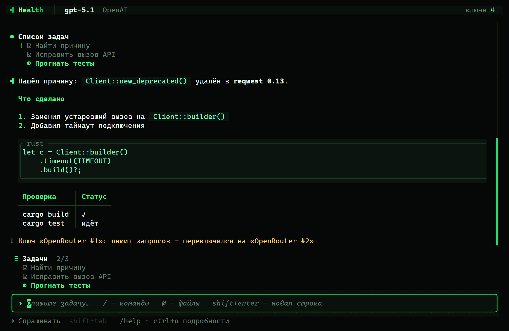
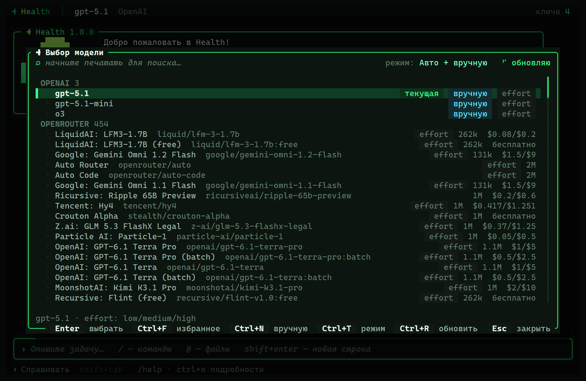
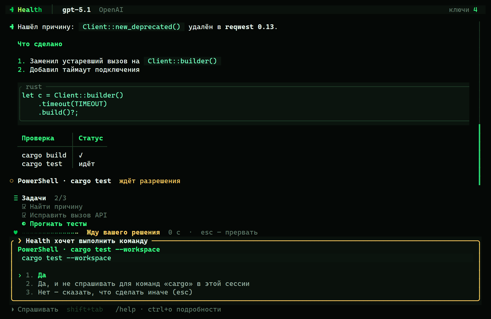
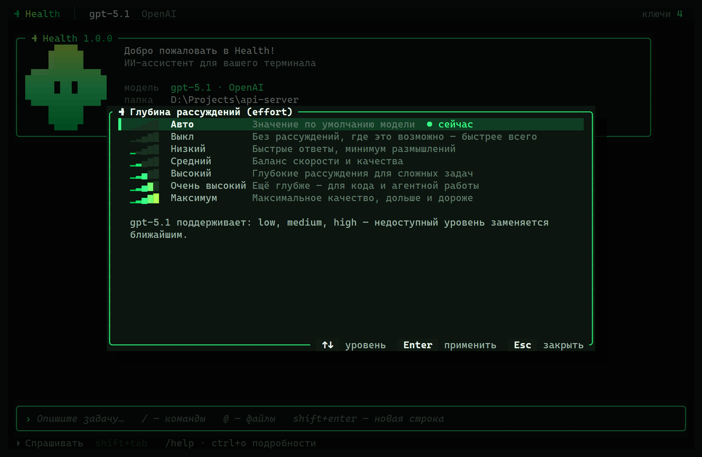
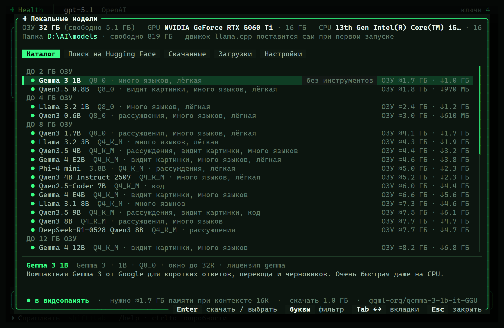
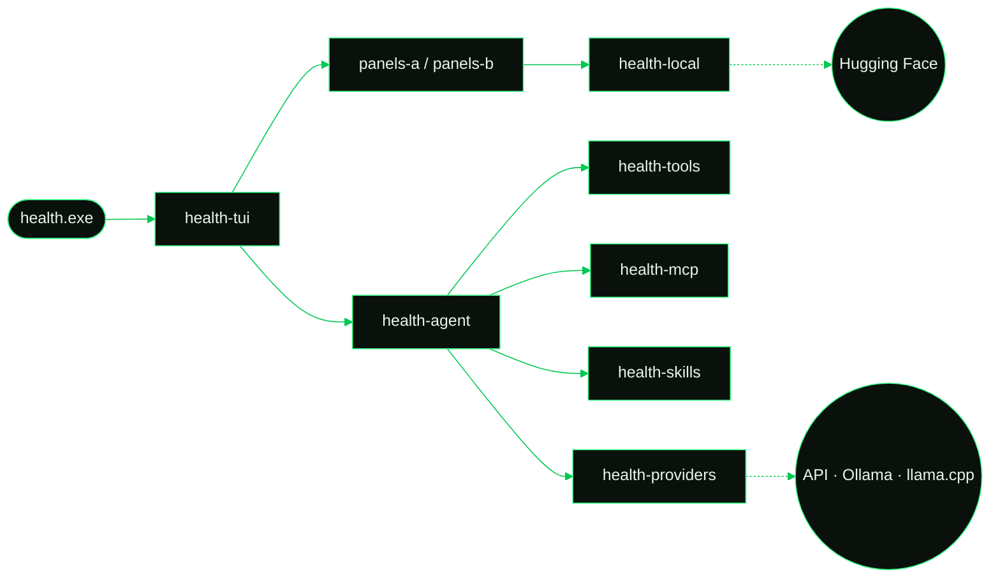

<div align="center">



<br>

<a href="#install"></a>
<a href="#build"></a>
<a href="#no-system-prompt"></a>
<a href="LICENSE"></a>

<br>

<code>&nbsp;<a href="#features">возможности</a>&nbsp;</code>
<code>&nbsp;<a href="#no-system-prompt">без промпта</a>&nbsp;</code>
<code>&nbsp;<a href="#install">установка</a>&nbsp;</code>
<code>&nbsp;<a href="#commands">команды</a>&nbsp;</code>
<code>&nbsp;<a href="#local-models">локальные модели</a>&nbsp;</code>
<code>&nbsp;<a href="#build">сборка</a>&nbsp;</code>

</div>

<br>

```console
PS C:\projects\api> health
  ✚  Health 1.1.0 · gpt-5.5 · Health Cloud
  › почини падающие тесты в src/net.rs
```

**Health** — полноэкранный ИИ-агент для терминала Windows. Он читает и правит файлы, запускает команды
и ищет по проекту, но перед каждым опасным шагом спрашивает разрешения. Подключите до **20 API-ключей**
от разных провайдеров или запускайте модели **прямо на своём ПК**: Health сам скачает и модель, и движок.

Ярко-зелёный на чёрном, с анимациями и маскотом — зелёным плюсом с глазами.
Одна `.exe`, без Node, Python и прав администратора.


<a id="features"></a>


<table>
<tr>
<td width="50%" valign="top">

**Агент, а не чат**

Правит файлы с цветным diff и ведёт список задач. Запускает PowerShell и cmd, ищет по коду,
загружает страницы. Режимы разрешений: *спрашивать*, *авто-правки* или *без подтверждений*
(переключаются клавишами <kbd>Shift</kbd>+<kbd>Tab</kbd>).

</td>
<td width="50%"></td>
</tr>
<tr>
<td width="50%"></td>
<td width="50%" valign="top">

**Любая модель — одной командой**

`/model` открывает поиск по всем моделям ваших ключей, `/model gpt-5.1` переключает сразу.
Список собирается **автоматически** из API провайдера, **вручную** или обоими способами.
Есть избранное, цены и поддержка effort.

</td>
</tr>
<tr>
<td width="50%" valign="top">

**20 ключей, ноль простоев**

Ключи одного провайдера работают как пул. При лимите (429), перегрузке или пустом балансе
Health переключается на следующий ключ и пишет об этом в ленте. Ключи хранятся в шифре
Windows DPAPI: расшифровать их может только ваша учётная запись.

</td>
<td width="50%"></td>
</tr>
<tr>
<td width="50%"></td>
<td width="50%" valign="top">

**Effort, MCP, скиллы**

Семь уровней глубины рассуждений, от «выкл» до «максимум». MCP-серверы подключаются по
stdio или HTTP, а готовый JSON-конфиг можно просто вставить. Скиллы — это папки
с `SKILL.md`, они запускаются как `/имя-скилла`.

</td>
</tr>
<tr>
<td width="50%" valign="top">

**Свои агенты**

`/agents` — создайте агента со своим промптом, моделью, effort и набором инструментов.
Основная модель запускает их через инструмент `agent`: каждый работает в отдельном контексте
и возвращает только итог, а запросы разрешений приходят вам.

</td>
<td width="50%" valign="top">

**Свой effort**

`/customeffort` — переименуйте уровни, удалите лишние, напишите к каждому свой промпт и выберите
модели, на которые это действует. Инструмент `custom_reasoning` позволяет модели самой открывать
и закрывать блок «Раздумье».

</td>
</tr>
</table>

<details>
<summary><b>Провайдеры из коробки</b></summary>
<br>

Health Cloud (вход через аккаунт: `/login`) · Anthropic · OpenAI · OpenRouter · Google Gemini · Groq · DeepSeek · Mistral · xAI · Together · Fireworks ·
Cerebras · Moonshot · Z.ai · NVIDIA · Hugging Face · любой OpenAI- или Anthropic-совместимый сервер ·
Ollama · встроенный llama.cpp.

Провайдер определяется по формату ключа; при необходимости его можно выбрать вручную.

</details>


<a id="no-system-prompt"></a>


Большинство агентов незаметно добавляют к каждому запросу несколько тысяч токенов своих инструкций.
Health не добавляет ничего. Модель получает только ваши сообщения, описания инструментов и, если вы
сами его задали через `/system`, ваш собственный системный промпт. Промпт уровня из `/customeffort`
тоже ваш: он отправляется, только если вы его написали и включили кастомный effort.

```diff
  POST /v1/chat/completions
  {
    "model": "gpt-5.1",
    "messages": [
-     { "role": "system", "content": "You are an expert coding agent. Always… (≈ 4 000 токенов)" },
+     { "role": "user", "content": "почини падающие тесты в src/net.rs" }
    ],
    "tools": [ "read_file", "edit_file", "powershell", "…" ]
  }
```


<a id="install"></a>


Одной командой в PowerShell:

```powershell
irm https://health-ai.lol/install.ps1 | iex
```

Или вручную:

1. Скачайте `HealthSetup.exe` со страницы [**Releases**](https://github.com/neflixoffical-cpu/health/releases) или соберите его сами ([как](#build)).
2. Запустите установщик. По умолчанию Health ставится в `%LOCALAPPDATA%\Programs\Health`.
   Установщик добавляет папку в `PATH`, создаёт ярлык в «Пуске» и запись в «Приложениях».
3. Откройте **новое** окно терминала и введите:

```powershell
health
```

При первом запуске мастер спросит язык (русский или English) и предложит войти через Health
(в браузере, как в других CLI-агентах; подписка подгружается сама), добавить ключ или скачать
локальную модель. Ключ проверяется сразу: Health запрашивает у провайдера список моделей.

<details>
<summary><b>Тихая установка и удаление</b></summary>
<br>

| | |
|---|---|
| `HealthSetup.exe /S` | тихая установка |
| `--dir <папка>` | своя папка установки |
| `--no-path` · `--no-shortcuts` · `--desktop` | не трогать PATH · без ярлыков · ярлык на рабочем столе |
| `HealthSetup.exe --uninstall` | удалить (также из «Параметры → Приложения» или `uninstall.exe`) |
| `--uninstall --purge` | удалить вместе с настройками, диалогами и моделями |

Установщик пишет только в `HKCU`, права администратора не нужны.

</details>


<a id="commands"></a>


| Команда | |
|---|---|
| `/model` · `/model <id>` | выбрать модель (поиск, избранное, ручное добавление) или переключиться сразу |
| `/keys` | API-ключи: добавить, проверить, включить и выключить, удалить (до 20) |
| `/effort [уровень]` | глубина рассуждений: авто · выкл · низкий · средний · высокий · очень высокий · максимум |
| `/customeffort` | свои уровни effort: названия, промпты, модели, инструмент `custom_reasoning` |
| `/agents` | свои агенты: промпт, модель, effort, инструменты; инструмент `agent` вкл/выкл |
| `/login` · `/logout` | войти через аккаунт Health Cloud · выйти |
| `/reset` | полностью сбросить настройки (подтверждение словом `healthreset`) |
| `/mode` | режим разрешений: спрашивать · авто-правки · без подтверждений |
| `/mcp` | MCP-серверы: команда или URL, импорт JSON, проверка, логи, доверие |
| `/skills` · `/<скилл> [аргументы]` | управление скиллами и их запуск |
| `/localmodel` | локальные модели: каталог, поиск на Hugging Face, загрузки, запуск |
| `/resume` · `/clear` | вернуться к прошлому диалогу · начать новый |
| `/system [текст]` | ваш системный промпт (по умолчанию его нет) |
| `/cost` · `/copy` · `/cwd` · `/lang` · `/config` · `/help` · `/exit` | всё остальное |

<details>
<summary><b>Горячие клавиши</b></summary>
<br>

| | |
|---|---|
| <kbd>Enter</kbd> | отправить |
| <kbd>Shift</kbd>+<kbd>Enter</kbd> · <kbd>Ctrl</kbd>+<kbd>J</kbd> · <kbd>\\</kbd> <kbd>Enter</kbd> | новая строка |
| <kbd>Esc</kbd> | прервать ответ |
| <kbd>Ctrl</kbd>+<kbd>Q</kbd> | плавная остановка: модель прерывается и аккуратно сворачивает начатое |
| <kbd>Shift</kbd>+<kbd>Tab</kbd> | режим разрешений |
| <kbd>Ctrl</kbd>+<kbd>O</kbd> | развернуть размышления и вывод инструментов |
| <kbd>@</kbd> | подсказка файлов проекта |
| <kbd>PgUp</kbd> <kbd>PgDn</kbd> · колесо мыши | прокрутка |
| <kbd>Ctrl</kbd>+<kbd>C</kbd> ×2 | выход |

Мышь работает везде: строки меню, вкладки, подсказки клавиш и кнопки нажимаются кликом.
Выделенный мышью текст в ленте копируется сам, как только вы отпустите кнопку.
Если ответ готов, а окно свёрнуто или в фоне, Windows покажет уведомление.

</details>


<a id="local-models"></a>




`/localmodel` показывает, сколько у вас ОЗУ и видеопамяти, и оценивает каждую модель:
**в видеопамять**, **в ОЗУ**, **впритык** или **не хватит**.

- **Каталог** — проверенные модели примерно от 2 до 80 ГБ ОЗУ: Gemma, Qwen, Llama, Phi, DeepSeek-R1 и другие.
- **Поиск на Hugging Face** — любая GGUF-модель, с размером и требованиями к памяти для каждой квантизации.
- **Загрузки** — с прогрессом, докачкой и проверкой SHA-256 в выбранную вами папку.
- **Движок** — официальный llama.cpp (CUDA, Vulkan или CPU, выбирается автоматически). Health ставит его сам.
  Модели запущенного **Ollama** тоже появляются в `/model`.


<a id="build"></a>


Нужны [Rust](https://rustup.rs) (stable, MSVC) и Visual Studio Build Tools с Windows SDK.

```powershell
git clone https://github.com/neflixoffical-cpu/health.git
cd health\sources
powershell -ExecutionPolicy Bypass -File build.ps1   # → ..\installer\HealthSetup.exe
cargo test --workspace                               # тесты
```

Промежуточные файлы идут в `%LOCALAPPDATA%\health-build` (другая папка задаётся переменной `CARGO_TARGET_DIR`).



<details>
<summary><b>Что в каком крейте</b></summary>
<br>

| Крейт | Что внутри |
|---|---|
| `health` | точка входа: аргументы, режим `-p`, сборка всего вместе |
| `health-tui` | полноэкранный интерфейс: лента, markdown, ввод, палитра команд |
| `health-panels-a` · `health-panels-b` | окна: модели, ключи, effort, кастомный effort, агенты, вход, сброс, режимы, настройки, MCP, скиллы, локальные модели |
| `health-ui` | общий интерфейс панелей |
| `health-agent` | цикл агента: стриминг, вызовы инструментов, разрешения, сохранение диалогов |
| `health-providers` | Anthropic Messages API и OpenAI-совместимые API, пул ключей, авто-парсинг моделей |
| `health-tools` | файлы, правки, поиск, PowerShell и cmd, загрузка страниц, список задач |
| `health-mcp` | клиент MCP (stdio и HTTP) |
| `health-skills` | скиллы (`SKILL.md`) |
| `health-local` | каталог моделей, Hugging Face, загрузки, llama.cpp |
| `health-theme` · `health-icon` | палитра, анимации, виджеты, маскот и иконка |
| `health-core` | общие типы, настройки, шифрование ключей |
| `health-setup` | установщик |

</details>

<details>
<summary><b>Где Health хранит данные</b></summary>
<br>

| Что | Где |
|---|---|
| настройки, ключи, MCP | `%APPDATA%\Health\config.json` |
| диалоги (`/resume`) | `%APPDATA%\Health\sessions\` |
| скиллы | `%APPDATA%\Health\skills\<имя>\SKILL.md`, `<проект>\.health\skills\` |
| модели, движок, логи | `%LOCALAPPDATA%\Health\` |

</details>


<details>
<summary><b>English</b></summary>
<br>

**Health** is a full-screen AI coding agent for the Windows terminal. It edits files, runs PowerShell,
searches your code and asks before anything risky. Use up to 20 API keys from different providers (with
automatic failover) or run GGUF models locally through llama.cpp, which Health downloads for you. It supports
MCP servers, `SKILL.md` skills, custom agents (`/agents`), custom effort levels with your own prompts
(`/customeffort`), sign-in with a Health Cloud account (`/login`), mouse control and soft stop (Ctrl+Q). **No hidden system prompt:** the model sees
only your messages, the tool definitions and your own `/system` prompt if you set one.
The UI is available in Russian and English (`/lang en`).

</details>

<div align="center">
<br>

<br>
<sub>сделано в консоли · <a href="LICENSE">MIT</a></sub>
</div>
